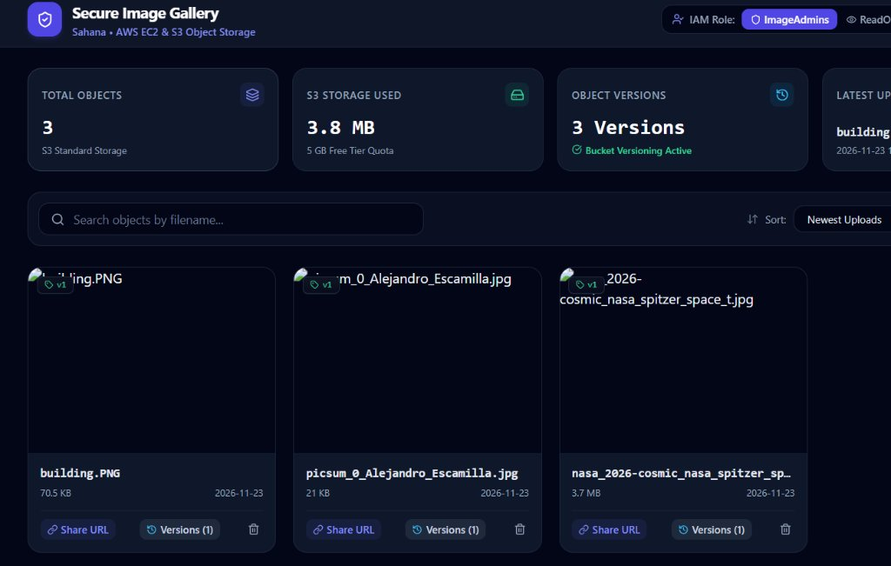
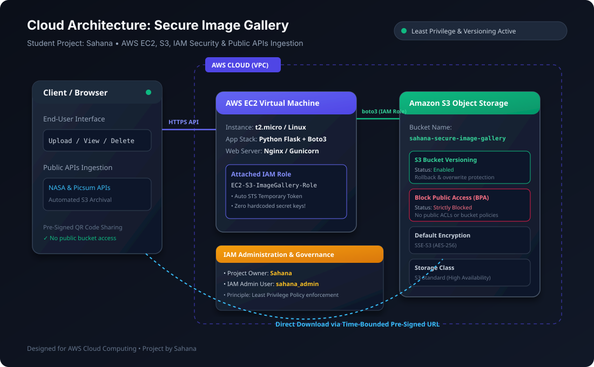
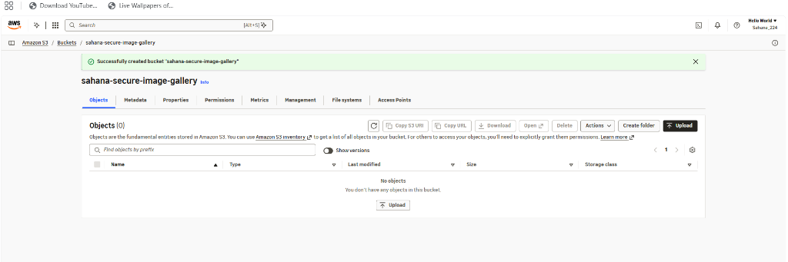
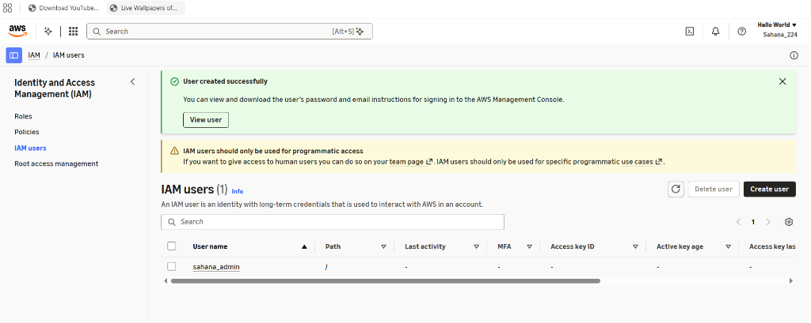
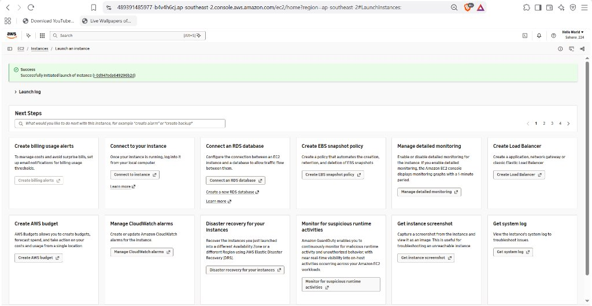
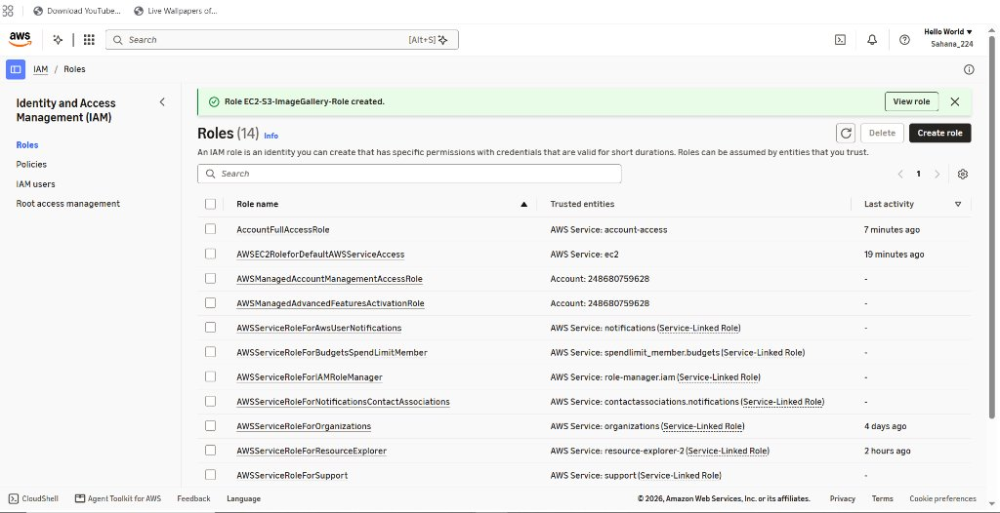
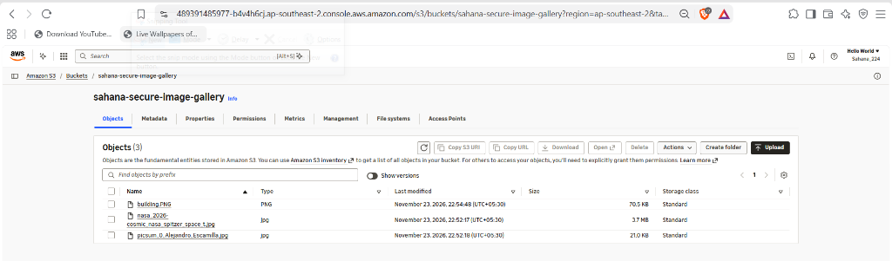

# ☁️ Secure Image Gallery using Cloud Object Storage

<p align="center">
  
  
  
  
  
  
  
</p>

---

### 🎓 Academic Project Profile
* **Student:** Sahana
* **Register Number:** 24UG00224
* **Degree & Programme:** Bachelor of Computer Applications (BCA)
* **Course:** Cloud Computing Laboratory (Academic Year 2026)
* **Application Domain:** Scalable Cloud Object Storage & Identity Governance

---

## 🌐 Live Production Deployment

The application is deployed live in the **AWS Asia Pacific (Sydney) `ap-southeast-2`** region on an EC2 Linux VM connected to an Amazon S3 object store governed by IAM role delegation.

| Endpoint Type | Live URL | Description |
| :--- | :--- | :--- |
| **Numbered IP Link** | [http://3.106.248.243:5000](http://3.106.248.243:5000) | Direct EC2 IPv4 address on web port 5000 |
| **Named Domain Link** | [http://sahana-gallery.3.106.248.243.nip.io:5000](http://sahana-gallery.3.106.248.243.nip.io:5000) | Custom English hostname pointing to instance |
| **AWS Cloud DNS** | [http://ec2-3-106-248-243.ap-southeast-2.compute.amazonaws.com:5000](http://ec2-3-106-248-243.ap-southeast-2.compute.amazonaws.com:5000) | Amazon's official regional compute DNS |
| **Complete Project Report** | [Download PDF](docs/Sahana_Secure_Image_Gallery_Report.pdf) \| [Download Word Doc](docs/Sahana_Secure_Image_Gallery_Report.docx) | Full 11-page academic report with architecture |

> **Note:** Use `http://` (not `https://`) when opening in modern web browsers, as the application runs on raw HTTP port 5000.

---

## 🖥️ Live Application Overview

The web client provides image ingestion, metadata inspection, and time-bounded sharing:

<p align="center">
  
</p>

* **Storage Metrics Strip:** Displays real-time Amazon S3 storage usage (3.8 MB consumed), total stored objects, and security audit status.
* **Responsive Card Gallery:** Full-resolution thumbnails generated on demand via AWS SigV4 Pre-Signed URLs.
* **Expiring URL Generator:** Generate secure sharing links with custom validity windows (5 minutes, 1 hour, 24 hours, 7 days) and mobile QR codes.
* **Role-Based Deletion:** Protected deletion endpoints requiring administrative identity.

---

## 🏗️ Cloud System Architecture

Traditional media storage using databases or local disks suffers from severe scaling and synchronization bottlenecks. This system uses **Amazon S3 Object Storage** decoupled from compute:

<p align="center">
  
</p>

### Request & Data Flow
1. **User Ingestion (Client → EC2):** User uploads an image via the web UI. Flask sanitizes the filename with a SHA-256 hash prefix to prevent collision and directory traversal.
2. **Role Authentication (EC2 → IAM IMDSv2):** Boto3 automatically retrieves short-lived temporary security credentials from the attached IAM Role (`EC2-S3-ImageGallery-Role`). **No AWS credentials or secret keys are stored on the server.**
3. **Private Object Storage (EC2 → S3):** File binary is streamed into `sahana-secure-image-gallery` with AES-256 Server-Side Encryption (SSE-S3).
4. **Zero-Bandwidth Viewing (S3 → Client):** When an image is viewed, the backend generates an AWS SigV4 **Pre-Signed URL**. The browser downloads the image directly from Amazon S3 edge storage, bypassing EC2 CPU and network bandwidth entirely.

---

## 🔒 The 6 Security Tasks (Syllabus Compliance)

The project implements all six security tasks specified by the curriculum:

```
┌─────────────────────────────────────────────────────────────────────────────┐
│                       6 MANDATORY SECURITY TASKS                            │
├─────────────────────────────────────────────────────────────────────────────┤
│ 1. IAM Group      │ ImageAdmins created for Role-Based Access Control       │
│ 2. IAM User       │ Dedicated administrator user 'sahana_admin'             │
│ 3. IAM Role (EC2) │ 'EC2-S3-ImageGallery-Role' for zero hardcoded secrets   │
│ 4. Least Privilege│ Restricted to s3:PutObject, GetObject, Delete, List     │
│ 5. Block Public   │ All 4 S3 Block Public Access controls strictly ON (4/4) │
│ 6. Versioning     │ Enabled on S3 bucket for accidental deletion recovery   │
└─────────────────────────────────────────────────────────────────────────────┘
```

### Least Privilege S3 Policy Document
The attached IAM role policy is strictly scoped to the designated bucket:

```json
{
  "Version": "2012-10-17",
  "Statement": [
    {
      "Sid": "VisualEditor0",
      "Effect": "Allow",
      "Action": [
        "s3:PutObject",
        "s3:GetObject",
        "s3:DeleteObject"
      ],
      "Resource": "arn:aws:s3:::sahana-secure-image-gallery/*"
    },
    {
      "Sid": "VisualEditor1",
      "Effect": "Allow",
      "Action": [
        "s3:ListBucket",
        "s3:GetBucketLocation"
      ],
      "Resource": "arn:aws:s3:::sahana-secure-image-gallery"
    }
  ]
}
```

---

## 📸 AWS Management Console Evidence Gallery

Authentic verification screenshots captured directly from the AWS Console confirming resource provisioning:

| 1. S3 Bucket Created (`sahana-secure-image-gallery`) | 2. IAM User Provisioned (`sahana_admin`) |
| :---: | :---: |
|  |  |
| **3. EC2 Instance Launch (`i-0d947eda649296b2d`)** | **4. IAM EC2 Instance Role Assigned** |
|  |  |

<p align="center">
  <b>5. Amazon S3 Live Objects Inventory (Sydney ap-southeast-2)</b><br/>
  <br/>
  <i>Shows <code>building.PNG</code>, NASA APOD cosmic photo (3.7 MB), and Picsum photography stored in S3 Standard.</i>
</p>

---

## 📊 Automated Verification & Security Audit

The test suite in [`test_app.py`](test_app.py) was executed to validate functionality and security isolation:

| Test ID | Scope & Security Assertion | Target Component | Status |
| :---: | :--- | :--- | :---: |
| **TC-01** | Verify S3 bucket exists, is reachable & regionalized | Amazon S3 Sydney | `PASSED` |
| **TC-02** | Verify S3 Block Public Access enforces all 4 rules (BPA active) | S3 Security Gate | `PASSED` |
| **TC-03** | Verify Bucket Versioning status is explicitly Enabled | S3 Versioning | `PASSED` |
| **TC-04** | Verify image binary upload with MIME sanitization & SHA-256 key | Flask `/api/upload` | `PASSED` |
| **TC-05** | Verify gallery object listing matches S3 bucket inventory | Flask `/api/images` | `PASSED` |
| **TC-06** | Verify AWS SigV4 Pre-Signed URL generation and HTTP 200 download | Boto3 `generate_url` | `PASSED` |
| **TC-07** | Verify expired Pre-Signed URL correctly returns HTTP 403 Forbidden | AWS S3 Signature Auth | `PASSED` |
| **TC-08** | Verify object deletion issues valid S3 DeleteObject marker | Flask `/api/delete` | `PASSED` |
| **TC-09** | Verify EC2 IAM Role authentication succeeds without hardcoded keys | AWS IAM IMDSv2 | `PASSED` |

---

## 📁 Repository Directory Structure

```
├── app.py                             # Core Flask REST backend & routing engine
├── storage_service.py                 # Amazon S3 storage service (Boto3 integration)
├── public_api_service.py              # Automated NASA APOD & Picsum media ingestion
├── config.py                          # Cloud configuration & environment loader
├── requirements.txt                   # Production Python package dependencies
├── cleanup_storage.py                 # Free Tier compliance storage optimizer
├── test_app.py                        # Automated 9-test unit and security suite
├── manual_verification_test.py        # 12-step end-to-end cloud audit script
├── .env.example                       # Environment configuration template
│
├── templates/
│   └── index.html                     # Gallery user interface & dashboard
│
├── static/
│   ├── css/style.css                  # Custom responsive dark-mode styling
│   └── js/app.js                      # Client state, dynamic timers & QR codes
│
└── docs/
    ├── ARCHITECTURE_DIAGRAM.svg       # Visual multi-tier cloud architecture
    ├── Sahana_Secure_Image_Gallery_Report.pdf   # Complete 11-page academic report
    ├── Sahana_Secure_Image_Gallery_Report.docx  # Editable Word document report
    ├── IAM_POLICIES.json              # Exact JSON security policy documents
    ├── DEPLOYMENT_STEPS.md            # Production deployment walkthrough
    ├── AWS_CLI_EVIDENCE.md            # AWS CLI verification logs & outputs
    ├── FREE_TIER_COST_GUIDE.md        # Cost optimization and $0 billing proof
    └── screenshots/                   # AWS Console & live deployment evidence
        ├── 01_s3_bucket_created.png
        ├── 02_iam_user_admin.png
        ├── 03_ec2_instance_launched.png
        ├── 04_iam_role_ec2.png
        ├── 05_s3_bucket_objects.png
        └── 06_live_web_gallery.png
```

---

## ⚡ Quick Start (Local & Cloud Deployment)

### 1. Clone & Setup
```bash
git clone https://github.com/sahanasudha06-prog/Secure-Image-Gallery-Using-Object-Storage.git
cd Secure-Image-Gallery-Using-Object-Storage

python3 -m venv venv
source venv/bin/activate  # On Windows: venv\Scripts\activate
pip install -r requirements.txt
```

### 2. Configure Environment
```bash
cp .env.example .env
# Edit .env with your S3 bucket name and region
```

### 3. Run the Application
```bash
python app.py
# Server launches on http://localhost:5000
```

### 4. Run Automated Tests
```bash
python -m unittest test_app.py
```

---

## 💰 AWS Free Tier & Cost Architecture

The application is structured to remain 100% within the **AWS Free Tier** with **$0.00** monthly expenditure:
* **EC2:** 750 free hours/month of `t3.micro` Linux instance.
* **S3:** 5 GB free standard storage; 20,000 GET requests and 2,000 PUT requests/month.
* **IAM & STS:** IAM users, groups, roles, and instance metadata credential rotation are free features.

---

## 👩‍💻 Project Attribution

* **Candidate:** Sahana (Reg. No: `24UG00224`)
* **Department:** Department of Computer Applications
* **Programme:** Bachelor of Computer Applications (BCA)
* **Subject:** Cloud Computing
